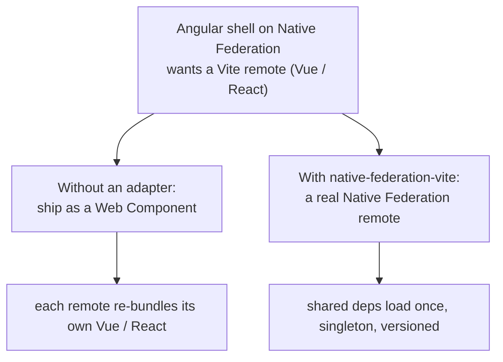
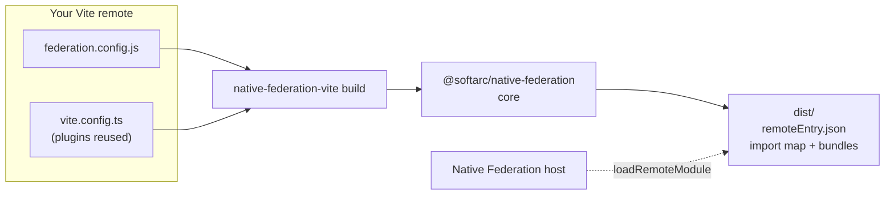

# native-federation-vite

> A **Vite adapter for Native Federation**. Build Vue/React (Svelte/Solid soon)
> micro frontends with Vite and expose them as real Native Federation remotes,
> consumable by an Angular shell (or any `@softarc/native-federation` host) with
> shared dependencies, singletons and versioning.

[](LICENSE)
[](https://www.npmjs.com/package/native-federation-vite)

---

## The problem

`@angular-architects/native-federation` has **1M+ downloads/week** on npm, and
Native Federation ships adapters for **Angular** and **esbuild**, but **not for
Vite**. A remote built with Vite couldn't produce a `remoteEntry.json`, so the
only option was shipping each remote as a Web Component, which **drops shared
dependencies** (every remote re-bundles its own Vue/React).

This adapter fills that gap.



## How it works

It is **built on the `@softarc/native-federation` core** (not a reimplementation).
The core normalizes the config, bundles shared deps and exposed modules, and emits
a spec-compliant `remoteEntry.json` + import map. This package plugs **Vite** in as
the bundler, the same way the esbuild adapter plugs in esbuild.



---

## Quick start

```bash
npm install native-federation-vite @softarc/native-federation --save-dev
```

**1. Declare what the remote exposes** (standard Native Federation config):

```js
// federation.config.js
import { withNativeFederation, shareAll } from '@softarc/native-federation/config'

export default withNativeFederation({
  name: 'vue-remote',
  // Expose at any granularity; a single page is a perfectly valid unit.
  exposes: { './CheckoutPage': './src/pages/Checkout.vue' },
  shared: { ...shareAll({ singleton: true, strictVersion: true, requiredVersion: 'auto' }) }
})
```

Don't want to list files by hand? Compute `exposes` from a glob (keys must be
unique; a collision throws):

```js
import { exposesFromGlob } from 'native-federation-vite'
// exposes: exposesFromGlob('src/pages/*.vue')
//   → { './Checkout': './src/pages/Checkout.vue', './Product': './src/pages/Product.vue' }
```

**2. Build it.** The CLI reuses your existing `vite.config.ts` plugins, so you
don't declare `vue()`/`react()` twice:

```bash
npx native-federation-vite build          # one-shot
npx native-federation-vite build --watch  # rebuild on change
```

```jsonc
// package.json
"scripts": { "build": "native-federation-vite build" }
```

That's it. `dist/remoteEntry.json`, the import map and the bundles are emitted by
the core. Any `@softarc/native-federation` host can now `loadRemoteModule('vue-remote', './CheckoutPage')`.

### CLI options

| Flag | Default | Meaning |
|---|---|---|
| `--config <path>` | `federation.config.js` | Federation config |
| `--out <dir>` | `dist` | Output directory |
| `--watch` | `false` | Rebuild on file changes |
| `--dev` | `false` | Dev build (no minify, sourcemaps) |
| `--vite-config <path>` | auto-detect | Vite config to reuse plugins from |
| `--no-vite-config` | `false` | Don't reuse any Vite config |

### Programmatic API

Prefer to drive it yourself? Use `runViteBuilder` (see [`examples/minimal-remote`](examples/minimal-remote)):

```js
import vue from '@vitejs/plugin-vue'
import { runViteBuilder } from 'native-federation-vite'

const { federationInfo, close } = await runViteBuilder('federation.config.js', {
  outputPath: 'dist',
  watch: true,
  adapterConfig: { plugins: [vue()] } // framework presets are opt-in
})
```

### API surface

| Export | Kind | Purpose |
|---|---|---|
| `native-federation-vite build` | CLI | Build a remote (flags above) |
| `runViteBuilder(config, options)` | function | Drive the build; returns `{ federationInfo, externals, close }` |
| `exposesFromGlob(patterns, options?)` | function | Compute `exposes` from a glob |
| `createViteAdapter(config?)` | function | Low-level `NFBuildAdapter` (advanced) |
| `ViteBuilderOptions` · `ViteAdapterConfig` · `ExposesFromGlobOptions` | types | Public TypeScript types |

---

## Web Components (opt-in)

Expose a component as a self-mounting custom element, so any host (Angular, React,
plain HTML) can `customElements.define(...)` it and drop in a `<tag>` with **no
framework-mount glue**, while `vue`/`react` stays shared via the import map:

```ts
// src/elements/button-element.ts  (exposed as ./ButtonElement)
import { defineCustomElement } from 'vue'
import Button from './FedButton.ce.vue'
export default defineCustomElement(Button)
```

```js
// host
const El = (await loadRemoteModule('vue-remote', './ButtonElement')).default
customElements.define('fed-button', El) // then use <fed-button></fed-button>
```

See [`examples/vue-remote/src/elements`](examples/vue-remote/src/elements) and the
runtime host in [`examples/html-shell`](examples/html-shell).

## Integrity (SRI) for production

Loading a remote means running its code in your host's origin. For production,
turn on integrity hashes so the host can verify each bundle (opt-in, one line,
handled by the core, no adapter change):

```js
// federation.config.js
export default withNativeFederation({
  name: 'vue-remote',
  exposes: { /* … */ },
  shared: { /* … */ },
  features: { integrityHashes: true } // adds sha384 SRI to remoteEntry.json
})
```

Pair it with HTTPS, trusted remote origins, and a Content-Security-Policy on the host.

## Compatibility

| Framework | Status |
|---|---|
| Vue 3 | ✅ verified |
| React 18+ | ✅ verified |
| Vanilla JS / TS | ✅ verified (see `examples/minimal-remote`) |
| Svelte 4+ | 🚧 planned |
| Solid | 🚧 planned |

Built and verified on **Vite 8 (Rolldown)** with **`@softarc/native-federation` 4.8.x**.

## Examples

- [`examples/vue-remote`](examples/vue-remote): Vue remote via the CLI (reuses `vite.config.ts`)
- [`examples/react-remote`](examples/react-remote): React remote via the CLI
- [`examples/minimal-remote`](examples/minimal-remote): framework-agnostic, programmatic API
- [`examples/angular-shell`](examples/angular-shell) / [`examples/html-shell`](examples/html-shell): hosts that consume the remotes

---

## Status

**`0.1.0` is on npm.** Early and built in public, so the API may still change before `1.0`.

- [x] Vite adapter on `@softarc/native-federation` core (`remoteEntry.json` + import map)
- [x] Shared dependencies, singletons, `@nf-internal/` chunking (handled by core)
- [x] CLI with automatic `vite.config` plugin reuse
- [x] Watch mode with shared-dependency cache
- [x] `exposesFromGlob`, opt-in Web Component expose, opt-in integrity (SRI)
- [x] Vue + React examples, validated in a host (shared deps load once)

## Roadmap

- [ ] Runtime validation inside a real Angular shell (not only the import-map host)
- [ ] React Web Component wrapper (parity with the Vue path)
- [ ] Svelte + Solid support
- [ ] Perf: warm/incremental build context (one `vite.build()` per bundle group today)
- [ ] `CONTRIBUTING.md` + issue/PR templates
- [ ] Upstream contribution ([native-federation/angular-adapter#184](https://github.com/native-federation/angular-adapter/issues/184))

---

## Related

- [`@softarc/native-federation`](https://www.npmjs.com/package/@softarc/native-federation): the core this adapter builds on
- [`@angular-architects/native-federation`](https://www.npmjs.com/package/@angular-architects/native-federation): the Angular adapter (1M+/week)
- [`@softarc/native-federation-esbuild`](https://www.npmjs.com/package/@softarc/native-federation-esbuild): the esbuild adapter (reference)

## License

MIT. See [LICENSE](LICENSE).
